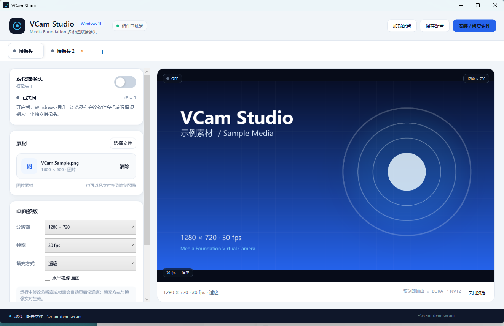

# VCam Studio

VCam Studio 是一个只面向 **Windows 11** 的 WPF 多标签页虚拟摄像头工具。每个标签页都是一路独立的虚拟摄像头，使用 Windows 11 的 Media Foundation 虚拟摄像头 API（`MFCreateVirtualCamera`）注册到系统。左侧控制开关、素材和画面参数，右侧实时预览；预览合成结果就是虚拟摄像头实际输出的画面。



## 功能

- 多标签页，每个标签页对应一路独立虚拟摄像头（最多 8 路并发）
- 启动后自动打开一个**不可关闭**的默认标签页；点击 `+` 新建标签页
- 关闭正在运行的标签页前会先检测摄像头状态，并提示先停止摄像头
- 左侧：摄像头开关、图片/视频素材、分辨率、帧率、填充方式、水平镜像
- 右侧：与虚拟摄像头输出一致的实时预览；可随时关闭预览以降低 CPU / 内存占用
- 支持把图片/视频直接拖到标签页
- 自动加载/保存配置，默认路径为 `%USERPROFILE%\.vcam`
  - 如果 `.vcam` 是一个目录，则使用其中的 `config.json`
  - 可用环境变量 `VCAM_CONFIG` 指定其他配置文件路径
- 支持图片与视频：图片走 WPF 解码；视频使用 Windows Media Foundation 解码（系统安装了什么解码器就支持什么格式）
- 无素材时输出带时间、通道名的动态测试画面
- 运行中修改分辨率/帧率会自动重启该路摄像头；填充方式、镜像实时生效
- 退出应用时停止所有虚拟摄像头并保存配置

## 1.0.6 更新

- **改为单文件发布**：主程序发布为单个 `VCamStudio.exe`，不再需要在旁边携带 `VCamStudio.Shared.dll`、`DirectNCore.dll` 等运行时文件
- COM 媒体源载荷（`VCamSource.comhost.dll`、`VCamSource.dll`、依赖清单和依赖库）现在嵌入主程序；安装/修复组件时自动释放到 `%ProgramData%\VCamStudio\Source`
- `build.ps1` 会检查发布结果，若出现额外运行时文件则直接报错，保证真正的单文件输出
- 清理构建中间目录、临时测试文件和未使用资源；发布包只保留单文件程序、说明文档和截图
- 1.0.6 仍兼容已安装的 1.0.3 COM 组件，无需强制重装

## 1.0.5 更新

- **移除所有悬停提示（ToolTip）**：标签栏 `+`、关闭按钮、摄像头开关等位置不再弹出黑色空提示框；按钮保留无障碍名称
- 修复关闭标签页、加载配置、安装组件或退出应用时与“正在启动/停止”的标签页竞争的问题，现在会等待状态切换完成再继续
- 优化日志复用：UI 与媒体源共用同一个滚动日志实现，并按实际可写目录打开日志
- 优化预览与测试画面的资源复用：冻结并复用画刷、画笔和字体，减少逐帧分配
- 修复素材加载失败状态被覆盖、缺失素材无法清除、切回标签页时开关可能被旧状态覆盖等问题
- 设备名称现在与标签页名称一致；清理未使用属性、转换器和重复代码
- 1.0.5 只修改主程序，**无需重新安装 COM 组件**

## 1.0.4 更新

- 新增 **“关闭预览”**：点击预览右下角的“关闭预览”即可暂停预览画面合成与刷新、释放预览位图；当没有摄像头输出且没有预览需求时，连帧泵定时器也会停止，明显降低 CPU 与内存占用。虚拟摄像头本身的输出不受影响；点击预览区域中的“开启预览”恢复
- 预览开关状态按标签页保存到配置（`showPreview`），重新启动后保持
- 修复鼠标悬停提示显示为 **黑色空框、没有文字** 的问题：全局 `TextBlock` 样式固定了深色前景，覆盖了 ToolTip 的白色前景，导致深色提示框上文字不可见；1.0.5 已直接移除所有 ToolTip
- 1.0.4 只修改主程序，**无需重新安装 COM 组件**

## 1.0.3 修复

- 修复使用浏览器/相机应用查看画面时 Windows Camera Frame Server 内存持续增长到 1–3 GB、系统卡顿的问题
- 原因：1.0.1 为绕开样本池耗尽，改为每帧用 `MFCreateSample` + `MFCreateMemoryBuffer` 新建样本；该路径没有背压，Frame Server 持续请求时样本会不断累积
- 修复：恢复为固定 12 个样本的 `IMFVideoSampleAllocatorEx`；分配器暂时为空时先回收 COM 包装并等待重试；每 5 帧释放一次 RCW。内存上限约为十几个 720p/1080p 样本，不再随播放时间增长
- 验证：`IMFSourceReader` 连续读取 120 帧 0 错误，工作集约 76 MB，未出现 `0xC00D4A3E` 或内存增长

## 1.0.2 修复

- 修复多个标签页的摄像头开关互相影响的问题
- 原因：标签页内容视图在切换时会被复用，开关的 OneWay 绑定在被代码直接赋值后被替换成本地值，导致切回第一个标签页时开关仍显示为第二个标签页的关闭状态
- 修复：开关状态改为从对应标签页的 ViewModel 推导，并使用 `SetCurrentValue` 更新显示，保留绑定；每个标签页的摄像头控制器和帧写入器本来就是独立实例
- 同时，关闭开关现在只调用 `IMFVirtualCamera.Stop()` 禁用当前摄像头，保留其注册到标签页关闭/应用退出；避免 `Remove()` 触发系统级设备移除通知，干扰其他正在使用的虚拟摄像头

## 1.0.1 修复

- 修复 Windows 相机预览画面闪烁、网页端只显示首帧后黑屏的问题
- 原因：媒体源原先使用固定样本分配器，在 1.0.1 中一度改为每帧新建样本以避免样本池耗尽；该方案在 1.0.3 中已替换为带背压的有界分配器

1.0.3 包含媒体源行为变化，需要更新 COM 组件：请运行新版应用并点击右上角 **“安装 / 修复组件”**，让 `%ProgramData%\VCamStudio\Source` 更新到 1.0.3。

## 系统要求

- Windows 11 Build 22000 或更高版本
- x64 进程
- [.NET 8 Desktop Runtime](https://dotnet.microsoft.com/download/dotnet/8.0)
- 首次安装 COM 组件需要**管理员权限**（UAC 一次）

> 虚拟摄像头媒体源是一个 COM 进程内组件，Windows Frame Server 会从 `%ProgramData%\VCamStudio\Source` 加载它，因此不能只注册到当前用户（HKCU），必须写入 HKLM。

## 构建

安装 .NET 8 SDK 后，在仓库根目录运行：

```powershell
.\build.ps1
```

输出：

- `dist\VCamStudio\VCamStudio.exe`：单文件主程序（应用依赖已打包，仍需安装 .NET 8 Desktop Runtime）
- `dist\VCamStudio-win-x64.zip`：发布压缩包

也可以手动执行：

```powershell
dotnet restore VCamStudio.sln
dotnet publish src\VCamStudio\VCamStudio.csproj -c Release -r win-x64 --self-contained false `
  -p:PublishSingleFile=true -p:IncludeNativeLibrariesForSelfExtract=true `
  -p:DebugType=None -p:DebugSymbols=false `
  -o dist\VCamStudio
```

单文件程序仍需要目标机器安装 **.NET 8 Desktop Runtime**。`VCamSource.comhost.dll`、`VCamSource.dll` 等 COM 载荷已嵌入 `VCamStudio.exe`，安装组件时会自动释放到 `%ProgramData%\VCamStudio\Source`，不需要在发布目录中单独保留。

> 单文件应用首次运行会把 WPF 原生库解压到 `%TEMP%\.net`。如果系统临时目录不可写，可把环境变量 `DOTNET_BUNDLE_EXTRACT_BASE_DIR` 指向一个可写目录后再运行。

## 安装与使用

### 方式一：应用内安装（推荐）

1. 运行 `dist\VCamStudio\VCamStudio.exe`。
2. 首次启动时点击右上角 **“安装 / 修复组件”**，在 UAC 提示中允许。
3. 安装完成后，在相机应用（Windows 相机、Edge/Chrome、Teams、OBS 等）中选择名称为 `摄像头 N` 的摄像头（Windows 会自动追加 `Windows Virtual Camera`）。
4. 回到 VCam Studio，打开标签页左上角的开关。

安装程序会从单文件程序中释放 COM 组件到 `%ProgramData%\VCamStudio\Source`，为 `Users` 授予读/执行权限（Frame Server 服务需要），把帧参数目录设为可写，然后调用 `regsvr32` 注册 8 个 CLSID。

### 方式二：脚本安装

以管理员身份运行：

```powershell
.\install.ps1
```

脚本会把发布目录复制到 `%ProgramFiles%\VCamStudio`，执行组件注册并创建开始菜单快捷方式。卸载：

```powershell
.\uninstall.ps1
```

### Windows 相机隐私设置

如果开启摄像头时报“访问被拒绝”，请打开：

**设置 → 隐私和安全性 → 相机 → 让桌面应用访问相机**

并确保开关已打开。

## 配置文件

默认配置文件：`%USERPROFILE%\.vcam`（JSON，UTF-8）。

```json
{
  "version": 1,
  "selectedIndex": 0,
  "tabs": [
    {
      "title": "摄像头 1",
      "slot": 0,
      "mediaPath": "C:\\Media\\intro.mp4",
      "mediaKind": "Video",
      "width": 1280,
      "height": 720,
      "fps": 30,
      "fitMode": "Contain",
      "mirror": false,
      "showPreview": true
    }
  ]
}
```

- `slot`：0–7，每一路必须唯一；关闭标签页后槽位可复用
- `width` / `height`：最大 1920×1080，必须是偶数
- `fps`：30 / 25 / 24 / 15
- `fitMode`：`Contain`（适应）、`Cover`（填充）、`Stretch`（拉伸）
- `mediaPath`：图片或视频的绝对路径；为空时输出测试画面
- `showPreview`：是否显示预览；关闭后停止预览合成并释放预览位图，虚拟摄像头输出不受影响（默认 `true`）

工具栏的“加载配置 / 保存配置”可以读取或另存其他 `.vcam`/`.json` 文件。加载配置会先停止当前所有虚拟摄像头。

## 实现结构

```
src/VCamStudio/             WPF 主程序（界面、预览合成、配置、MFCreateVirtualCamera 调用）
src/VCamStudio.Shared/      共享帧协议、共享内存读写、槽位/CLSID 定义、槽位参数
src/VCamSource/             COM 媒体源（IMFActivate + IMFMediaSourceEx + IMFMediaStream2），由 Frame Server 加载
```

### 帧链路

1. WPF 在 UI 线程用 `DrawingVisual` + `RenderTargetBitmap` 把图片/视频/测试画面合成为 BGRA 帧。
2. 帧写入由媒体源创建的命名共享内存（`Global\VCamStudio.Frame.{CLSID}`），使用 seqlock 保证读写一致。
3. Frame Server 中的 COM 媒体源在 `RequestSample` 时读取最新帧，按协商好的 NV12 或 RGB32 格式写入 Media Foundation 采样并送入管道。
4. 因为 Frame Server 运行在服务会话，共享内存必须位于 `Global\` 命名空间；媒体源用宽松但仅限本机认证用户的 DACL 创建它。

### 虚拟摄像头注册

- `CameraSource1` … `CameraSource8` 是 8 个 COM 类，每个有独立 CLSID。
- 标签页开启时调用：

```csharp
MFCreateVirtualCamera(
    MFVirtualCameraType_SoftwareCameraSource,
    MFVirtualCameraLifetime_Session,
    MFVirtualCameraAccess_CurrentUser,
    friendlyName,
    "{CLSID}",
    null, 0,
    out IMFVirtualCamera camera);

camera.Start(null);
```

- `Lifetime_Session` 表示关闭摄像头/退出应用后自动从系统摄像头列表移除，不会留下持久设备。
- 每个标签页使用不同 CLSID，因此多路摄像头可以同时存在。

## 日志与排错

- WPF 日志：`%LOCALAPPDATA%\VCamStudio\logs\vcamstudio.log`
  - 如果该目录不可写，会退化到程序目录下的 `logs\vcamstudio.log`
- 媒体源日志：`%ProgramData%\VCamStudio\logs\vcamsource.log`
- 组件安装目录：`%ProgramData%\VCamStudio\Source`
- 槽位参数：`%ProgramData%\VCamStudio\slots\slotN.json`

常见问题：

| 现象 | 处理 |
| --- | --- |
| 开启摄像头提示组件未安装 | 点击“安装 / 修复组件”，允许 UAC；不要只复制 exe，必须让安装器注册 COM |
| 开启摄像头提示访问被拒绝 | 打开 Windows 相机隐私开关，允许桌面应用访问相机 |
| 相机应用里看不到设备 | 先开启对应标签页的开关；确认组件状态为“组件已就绪”；重启相机应用 |
| 相机应用能选到设备但黑屏 | 检查媒体源日志；确认 `%ProgramData%\VCamStudio\Source` 对 `Users` 可读；某些应用需要关闭再打开 |
| 视频无法播放 | Windows 缺少对应解码器；可先转成 H.264 MP4 再试 |
| 安装/修复失败 | 查看 `%ProgramData%\VCamStudio\logs`；确认 Frame Server 没有占用旧 DLL（退出所有使用虚拟摄像头的应用后重试） |

## 已知限制

- 最多 8 路并发虚拟摄像头。每一路需要一个独立注册的 COM CLSID，这是 Windows 虚拟摄像头按 source id 区分设备的直接结果。
- 最大输出 1920×1080，30/25/24/15 fps。
- 不包含音频；虚拟摄像头只提供视频流。
- 视频解码依赖系统 Media Foundation 解码器，格式支持范围由系统决定。
- 当前用户会话只允许运行一个 VCam Studio 实例。
- 共享内存帧通道面向本机单用户场景；不同 Windows 用户同时运行多实例不在当前支持范围。

## 第三方组件

见 [THIRD-PARTY-NOTICES.md](THIRD-PARTY-NOTICES.md)。核心 Media Foundation 互操作使用 [DirectN](https://github.com/smourier/DirectN)（MIT）。媒体源实现参考了 Simon Mourier 的 [VCamNetSample](https://github.com/smourier/VCamNetSample)（MIT）。
